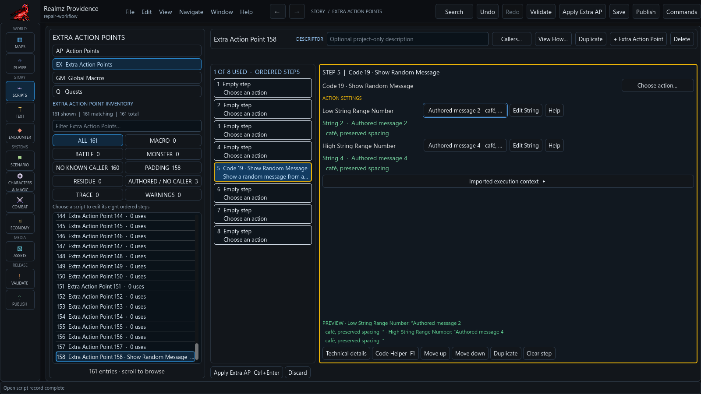
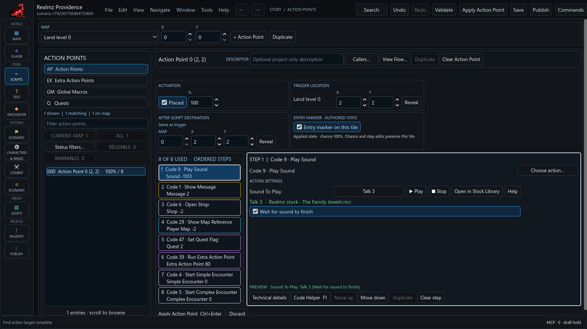

# Action Point entry and activation

An Action Point's placement, tile entry marker, authored chance and program
checks are separate facts. They do not form a single saved active/inactive flag,
and the editor does not infer a player's current quest state or route access.

Use the existing Action Point editor to change placement, chance, destination
and ordered steps. **Entry marker on this tile** explicitly changes the map
cell when you Apply. Marker and record edits share one Undo transaction.
Changing only chance or steps preserves the existing tile encoding.

For a reusable program, select **Extra Action Points**, choose its record, and
select the step to edit. **Choose action…** opens the action picker; the selected
action supplies its settings controls. Apply the Extra AP draft before saving
the project or following another record through a guarded navigation.

The screenshot is a prepared authored example in the current native development
build. It shows actual controls and sample text; it is not a scenario walkthrough.

Moving or placing an AP marks its destination. Apply that placement before
editing the destination marker. Unplaced APs have no tile marker to edit.
Land secret tiles use the map's existing secret controls; the AP editor provides
an **Edit map secret** link. Dungeon marker edits preserve direction and secret
bits, but removing the marker changes how the entrance is processed. A marker
can also affect movement through solid terrain.

Multiple imported APs may share one coordinate. Native record order determines
which placed record takes precedence, including dormant records. Filtering or
renaming a record does not change that order. Use the earlier-AP link to inspect
the record that takes precedence; marker changes apply to their shared cell.

## Choose a resource and its behavior

Some actions use the sign of a resource number to select a different behavior.
Choose the resource normally, then use the named checkbox below its settings:

- Sound: **Wait for sound to finish**.
- Message: **Continue without waiting**.
- Shop: **Open immediately**.
- Player Map: **Display immediately**.
- Quest: **Clear quest flag**.

Changing the resource keeps the selected behavior. These are draft changes;
Apply records them together, Undo/Redo restores them, and Save makes them durable.
The same controls appear in Action Points, Extra Action Points and Simple or
Complex Encounter steps, including applicable Extra Code settings.

A checkbox appears only where that action actually supports the alternative.
For example, Heal and Damage always use the absolute message number, so their
message field has no waiting checkbox. A conditional message/XAP field offers
message behavior only in its message mode. Zero has no distinct negative form;
an unavailable checkbox explains that boundary. Imported values stay intact.

This prepared authored example shows the real native controls; it is not a
scenario walkthrough.

Some native settings serve two purposes. A Battle sound can also select the
revive-loss XAP; waiting cannot make that destination negative. The Spell Points
sound also supplies Minimum Spell Points, so the quantity limit still applies.
These fields name both uses and explain unavailable choices beside the control.

## Find records by their applied state

The AP catalog's **Status filters** and the map overlay menu share four filters:

- Chance: all, positive, or nonpositive. Nonpositive chance is dormant authored
  eligibility; it does not remove the AP definition.
- Entry marker: all, present, absent, or unavailable.
- Precedence: all, an earlier AP takes precedence, or first at the coordinate.
- Program checks: all, detected check/branch steps, or unknown instructions.

Filters intersect and retain the catalog's map/all/reusable/warnings scope and
search. Result counts and Reset remain available for empty intersections.
Apply or discard an AP draft before changing its catalog filters. Map filters
change displayed markers, selection hits and image export; they do not edit
source data or change native precedence. All placed APs are displayed by default.
Entry markers without an AP are preserved map content, not executable records.

## Follow the program context

The map sidebar and View Flow show applied placement and activation facts.
Unapplied edits stay in the editor. Flow retains the ordered steps and exact
owning-field navigation. Calls and chance changes are different relationships:
a chance change does not call a program or establish when the player reaches it.

Detected checks identify recognized instructions in this AP. They do not analyze
every called program or prove that no other condition exists. Unknown
instructions remain preserved. Program checks may prevent later effects even
when the player can physically enter the tile. These views are authoring context,
not a live playthrough evaluator or a guarantee of reachability.

Current development exports use schema v6 for both imported and newly authored
scenarios, retaining exact signed native tile words. Older package contracts
remain readable. The published beta's contract is recorded separately in
[package versions](package-versions.md). A separate compatible Rebuilt
installation is needed for playtest.

For a Display Random Message action with missing or unresolved settings, see
[the native Random Message repair guide](random-message-repair.md). Its range
preview, exact Message picker and shared scope operate on a repair draft; Save
remains explicit.
