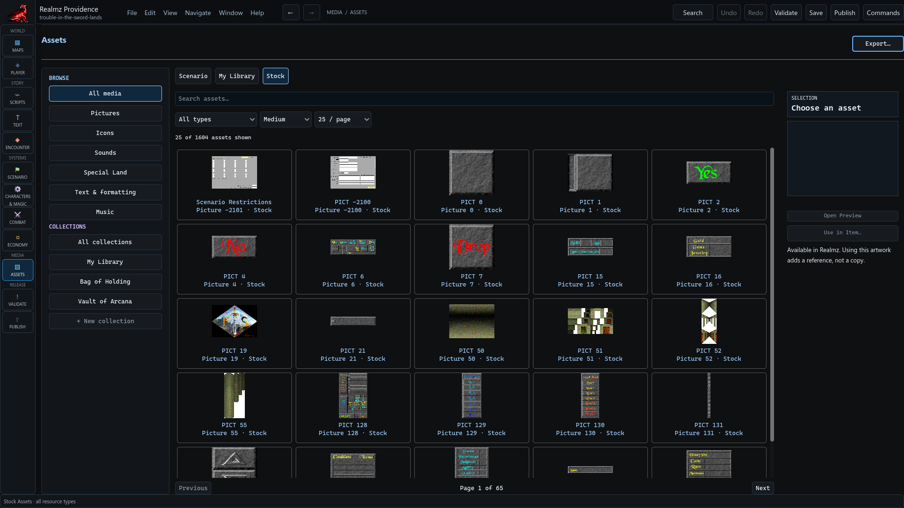

# Select and apply media

Open **Media / Assets** to browse scenario media and reference libraries. The
selected collection determines which content you own and which content is a
copy source. Keep the actual resource identity when following a reference.

## Browse and inspect

Filter the catalog by the available type, name and collection controls. Select
the actual image, sound, icon or text resource and open its preview. Image zoom
changes presentation; playback and text reading do not edit the project.

An exact scenario resource can override the matching application resource.
Missing, ambiguous, wrong-kind or malformed content needs its own resolution;
do not assume that a stock picture will replace every bad scenario override.

## Import or transfer deliberately

Use the gallery's import/transfer workflow for the supported media type. Review
the target resource, ownership and proposed change before applying it. Choosing
art for an item or monster is separate from changing that record's mechanics.
Reference-library payloads are not copied into scenario assets merely because
the editor displays them.

See [supported formats](supported-formats.md) before preparing external artwork,
sound or music. Unsupported imported originals can be retained as source evidence
while their unusable runtime projection is quarantined. This does not make the
unsupported variant editable. Arbitrary resource editing and general tracker
support are outside the promised native workflow.

Apply the intended change, Save, then check the target readiness. A successful
media preview does not establish runtime role resolution, spell execution or
whole-campaign compatibility. Keep those checks separate.
