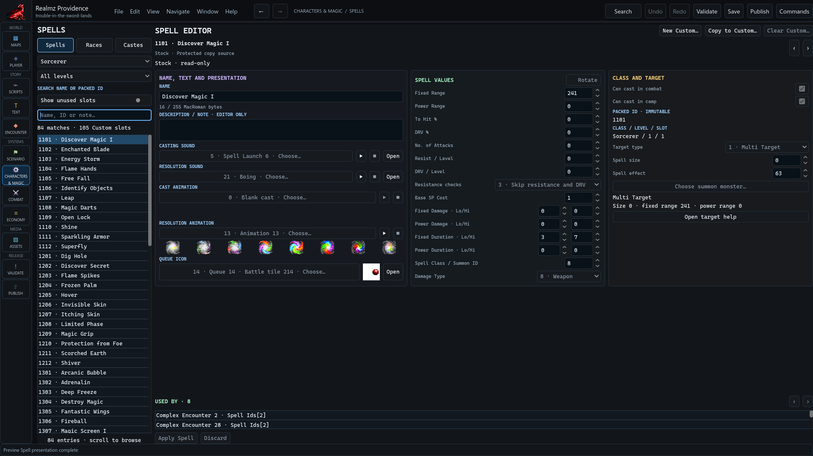

# Author Characters & Magic

Open **Characters & Magic** for **Spell Editor**, **Race Editor** and **Caste
Editor**. Select the exact definition before editing. Eligibility, presentation
and mechanical definitions have different roles; an application placeholder is
not automatically a new scenario rule.

## Spells

Use **Search name or packed ID** and the stock/custom catalog. Stock is a copy
source. **New Custom…** or **Duplicate…** opens the supported authoring path;
the packed class/level/slot identity remains fixed once allocated.

Edit names, values, class/target, costs, damage/duration and cast eligibility in
the owning form. The description/note is editor-only. Choose casting/resolution
sounds, animations and queue icon deliberately, then Apply and Save.

The animation controls preview the exact eight-frame resource. They do not cast
the spell or prove field/combat execution. Verify consumed resources, effect
order, targets and Save/reload consequences in the separate runtime.

## Races and castes

The author-facing Race and Caste numbers are 0–29. Use the displayed number and
name when selecting or following references; their internal package identities
are separate. Missing names do not imply that a populated definition is absent.

Review restrictions and reference choices before applying a custom definition.
Fresh authored definitions must pass semantic and reference checks. Wider values
representable by the current v6 package are not permission to use undefined
tables, missing references or imported-only quarantine rules.

If an operation is unconfirmed, use **Check original result** or review the saved
version through the editor's recovery controls. A successful replay does not
justify overwriting a newer authored draft.
