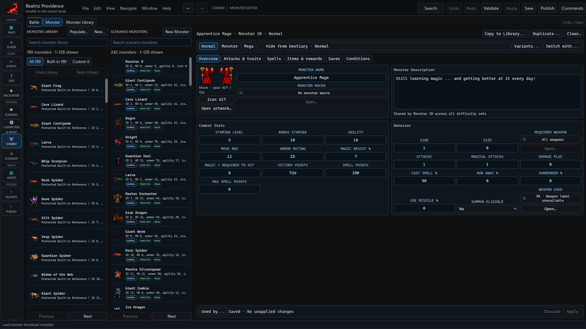
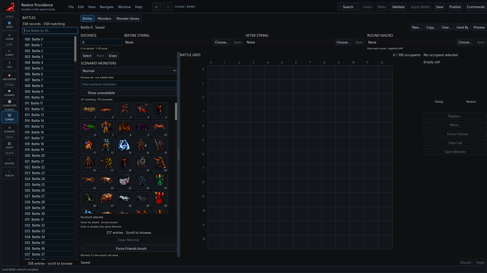

# Author monsters and battles

Use **Combat → Monster Editor** for scenario records, **Monster Library** for
copy sources and **Battle Editor** for placements. A library entry and a placed
scenario monster have different ownership and history.

## Prepare the monsters

Select a scenario monster and its Normal, Monster or Mega set. Edit the named
tabs for stats, attacks/traits, spells, rewards, saves and conditions. The
description is shared across difficulty sets; inspect variants before changing
shared presentation or mechanics. Use **Used by…** to follow known callers.

**Duplicate…**, **Copy to Library…**, **Copy to Scenario…** and population actions
have their own allocation/review steps. Review occupied IDs and copy consequences
before confirming. Copying source content into a draft or library does not
silently replace an existing scenario record. Do not infer a missing difficulty
variant from the Normal set.

Monster names allow 40 native MacRoman bytes; descriptions use a 255-byte text
record. Apply validation rejects unsupported characters. Imported untouched
padding or malformed text can remain preserved; that is not permission to author
an invalid new value.

## Build a battle

Choose **New…** or **Copy…**, set distance, before/after Strings and the round
macro, then place scenario monsters on the battle grid. **Select**, **Paint** and
**Erase** serve different actions. Review facing, Force Friends and occupied
cells before Apply. Monster zero is the empty-cell value.

The preview difficulty set is a view choice, not a Battle field. It does not
change which native difficulty records the runtime will select. A round macro
is a recurring combat effect, not a one-time post-battle reward.

Apply and Save, inspect the callers, then verify the encounter and aftermath in
the separate runtime. A visual battle preview or animation-frame preview does
not execute all combat/spell effects. Auto Win can stand in for a winnable fight
when testing progression; still record rewards, consumed resources and choices.
