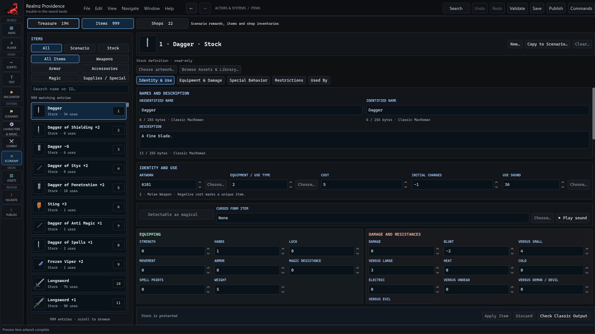

# Author items, treasure and shops

Open **Economy** and select **Items**, **Treasure** or **Shops**. They own different
parts of a reward or purchase. Linking an item number does not grant the player
that item until the relevant encounter or effect runs.

## Items and artwork

Use the Item catalog's **All**, **Scenario**, **Stock** and category filters to
find the intended record. Stock supplies copy sources. **New…** and **Copy to
Scenario…** create through the editor's allocation/review workflow. Edit the
scenario record's mechanics, restrictions and presentation, then **Apply Item**.

**Choose artwork…** and **Browse Assets & Library…** select presentation. Review
the explicit transfer/apply action; browsing an asset does not change item
mechanics. **Back to Assets** returns to the source context. **Check Classic
Output** verifies that editor's output boundary, not an entire campaign.

## Treasure and shops

Select the actual treasure or shop record, review its item references, quantities,
prices and conditions in the owning form, and apply the change. Inspect callers
to confirm which script grants that treasure or opens that shop. Check whether
the script consumes another item, charges money, changes a quest or permits a
return visit.

Keep Apply, Save and runtime acquisition distinct. An item existing in the
catalog does not prove that the party can obtain or afford it. Use an ordinary
route or an explicitly prepared checkpoint to verify the required resource
state. If the original write result is uncertain, use **Check original result**
before retrying an Item operation.
