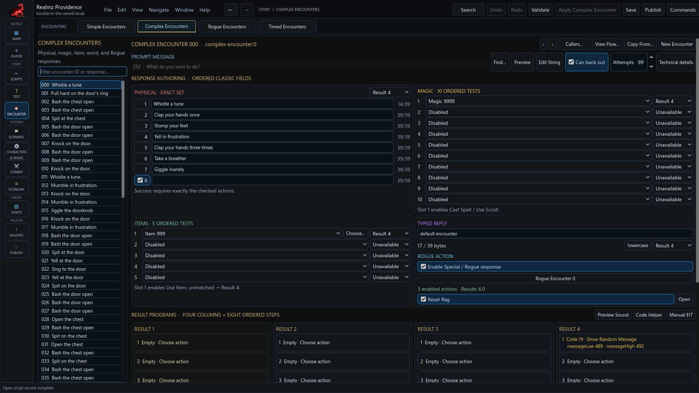

# Author encounters

The **Encounters** activity contains Simple, Complex, Rogue and Timed editors.
Choose the record by its actual number, edit its owning form and Apply. Save is
separate. **Callers…** and **View Flow…** inspect the applied connections.

## Responses and results

A Simple Encounter has four response fields and four result programs, each with
eight ordered steps. Choose the prompt String through **Find…**, **Preview** or
**Edit String**. Map each response deliberately to its result. Imported eliminated
or invalid choices retain their own diagnostics; do not replace them merely
because they do not behave like a new ordinary choice.

Complex Encounters have physical, magic, item, typed-reply and Rogue controls.
Respect their displayed ordering and enablement rules: physical success requires
the exact checked set, while the first magic/item slot enables that response
family. Review unmatched outcomes and the four result programs. The typed-reply
form explains its lowercase and first-authored-space matching rule.

Use **New Encounter** or **Copy From…** through the owning editor. Copying values
into a draft does not apply or save them. Changing a referenced String is its
own authoring operation; keep track of which form still has an unapplied draft.

## Native text limits

Simple response labels allow 79 MacRoman bytes each. Complex inline response
fields allow 39 bytes each. Prompt messages use the separate 255-byte String
record. Meaningful whitespace and representable high-bit characters are retained;
unsupported characters require a deliberate replacement. Apply/export validation
is authoritative even where a control has only a character counter.

## Rogue and Timed behavior

Rogue Encounters author available actions, success/failure results, text, sounds,
traps and locks. **Returns to** identifies the caller context. Keep that owner
explicit when previewing a Rogue result.

Timed Encounters expose midnight day, increment, chance, XAP, item, quest and
position requirements. Negative days remain dormant until rescheduled; zero
chance retains the record while disabling eligibility. Inspect increment and
gate order before relying on a schedule. A direct XAP preview is not a scheduler
test. Capability-gated Timed runtime preview remains a closeout item.
