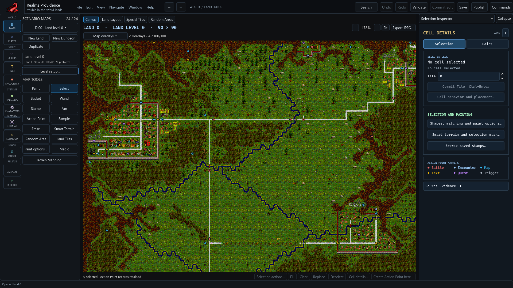
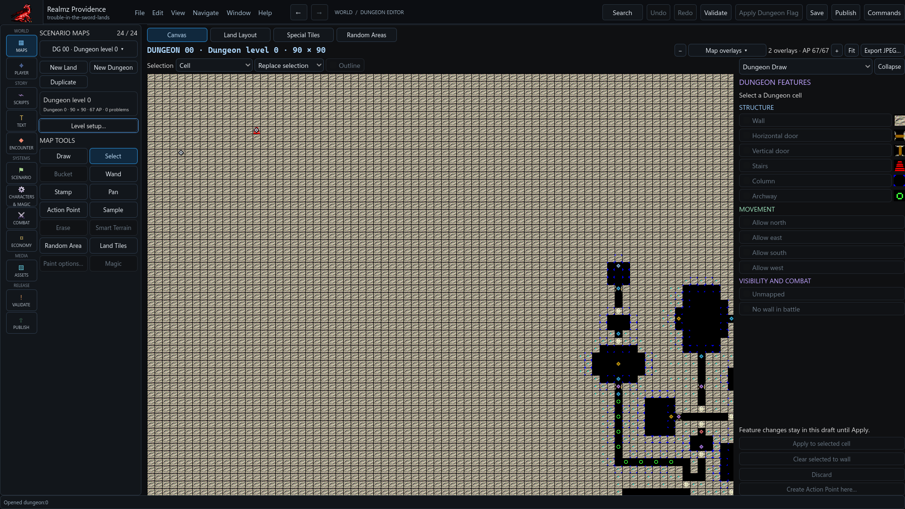

# Author Land and Dungeon maps

Open **Maps** and select **Land Editor**, **Dungeon Editor**, **Land Layout** or
**Special Land Tiles**. Create or duplicate a level through its map controls.
Check the selected level before painting or placing events.

## Paint and review

Choose the exact tile or supported brush, then use the workbench's Paint,
selection, fill or stamp controls. Review staged operations and use Apply or
Cancel where that workflow offers a preview. Undo reverses applied map changes;
Save persists them. Changing the visible overlay is a view operation.

The Magic Brush supplies the existing supported connection planning. Dedicated
road/path and wall brush controls are still a closeout item. Custom artwork
needs reviewed connections; decorative doors, bridges and unsupported pieces
remain exact-tile operations. Artwork resemblance does not establish collision
or directional behavior.

## Connect places deliberately

Inspect map edges and transitions, Action Point placement, random rectangles,
secrets, boats and Dungeon direction features where they affect the route.
Land artwork and Dungeon collision/entry settings have different meanings.
Set the starting location in [Scenario](scenario-shell.md), then verify that the
player can approach the intended event and can leave or return as designed.

An [Action Point](action-points.md) has its own placement and activation facts.
Dormant records can be changed by later instructions. Map filters and View Flow
show applied authoring context; neither runs the party's current eligibility
checks or proves that a route is reachable.

## Publish and inspect

Current development exports use v6 with signed native tile words for authored
and imported scenarios. Representability does not make every numeric tile
semantically valid. Use the supported native controls and resolve reference or
resource findings before exporting.

Map image export uses the active view's overlay choices. A readable map image
is documentation, not a movement or encounter replay. Keep complete-map analysis
separate from what the player has discovered in a runtime test.
