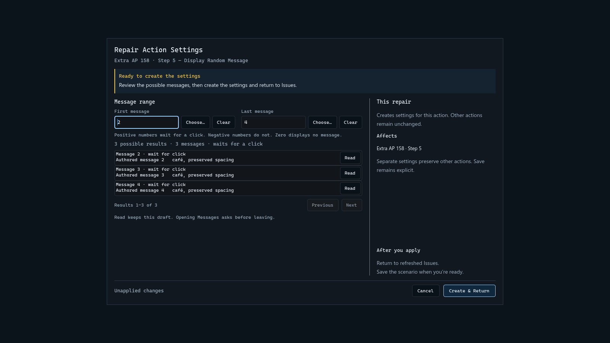
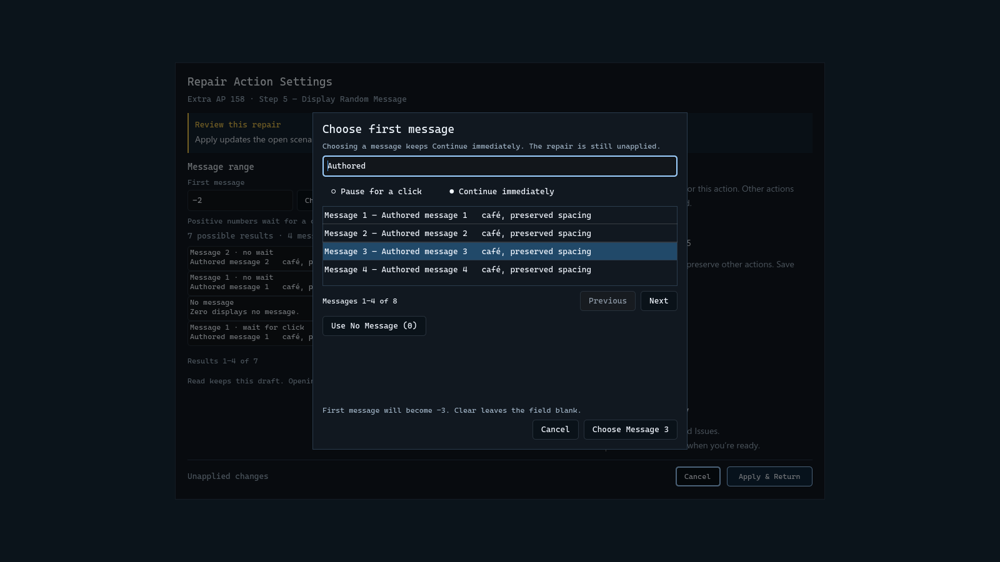
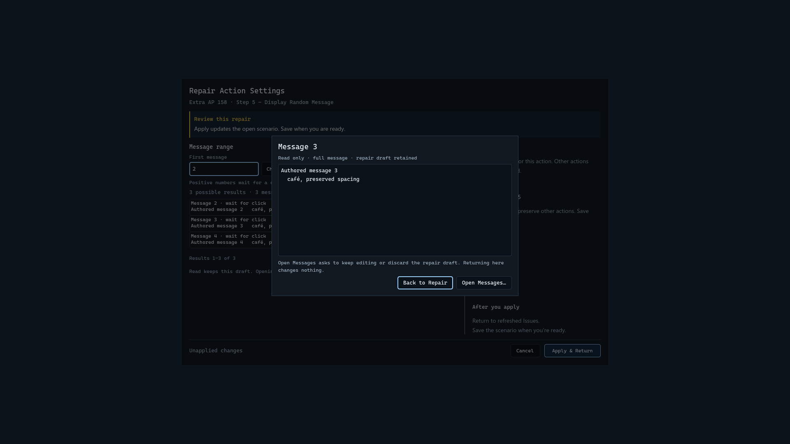
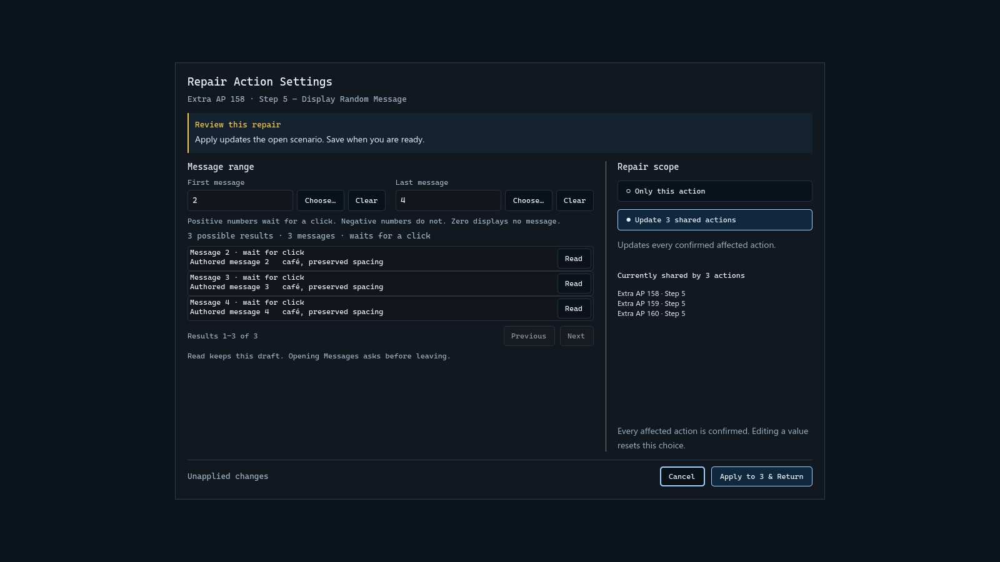
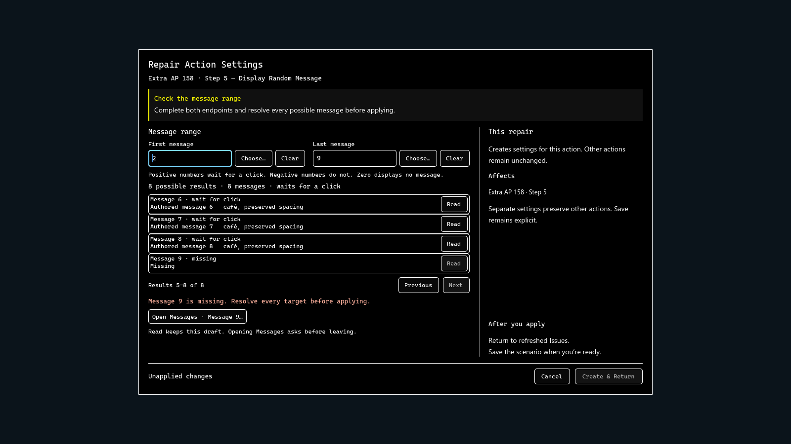
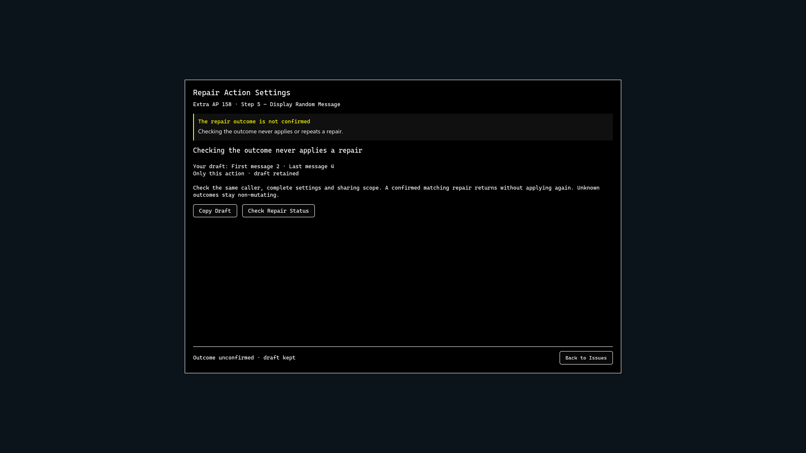

# Repair a Random Message action

This guide describes the current native development build. Its screenshots show
an authored sample project in the current editor; their message text is illustrative.
The installed beta is documented separately in [the beta release notes](beta-release.md).

Display Random Message uses two signed endpoints to choose a native result.
Use its guided repair from Issues when the settings or a message target need
attention. Applying the repair updates the open project. Save is a separate step.
Messages are edited in the native **Strings** workbench; the repair's **Open
Messages** action opens that owning editor.

## Set the range

1. In Issues, select the Random Message finding and open its repair.
2. Enter **First message** and **Last message**, or use **Choose…** to search
   existing Messages. The picker requires an explicit selection.
3. Review the result preview. It shows four results per page; use
   Previous and Next to inspect more. Its total and wait summary describe the
   whole range, including targets on other pages.
4. Choose the repair scope, then apply when every target is resolved. The button
   says **Create & Return** for missing settings, **Apply & Return** for an
   existing isolated repair, or names the confirmed action count for a shared
   repair. Issues refreshes afterward. Save the project when ready.

Each endpoint is a signed whole number. A positive result displays that Message
and waits for a click; a negative result displays the same Message without
waiting. Zero displays no message. For example, `-1` through `1` can produce
Message 1 with either wait behavior, or no message.

Imported reversed or wrapped ranges retain their native behavior. Read the
calculated results before changing them. The editor does not sort the endpoints
or promise that every unusual range behaves like an ordinary ascending interval.

## Choose, read and clear

**Choose…** searches existing Messages. Choose **Pause for a click** or
**Continue immediately**, select the exact Message, then confirm. Choosing a
Message changes the repair draft; it does not apply the repair.

**Use No Message (0)** explicitly sets zero. **Clear** leaves the endpoint blank; a blank
endpoint is required input and blocks Apply. They have different meanings.

**Read** opens the complete text of one resolved Message. **Back to Repair**
keeps the draft. **Open Messages** opens its owning editor through the draft
guard: keep editing to stay in the repair, or explicitly discard the unapplied
repair values before leaving. Reading itself changes no project data.

## Repair shared settings deliberately

**Only this action** creates independent settings when another action shares
the current row. Other callers keep their existing settings. Review the listed
uses before selecting **Update shared actions**. That choice confirms the exact
affected callers; changing a value resets the confirmation.

If another action uses these words differently, shared overwrite is unavailable.
The form explains the conflict and keeps isolated repair available. It never
silently updates those other callers.

This shared form applies to Random Message. Random Area currently offers
isolated repair; restoring its shared path is still tracked as unfinished work.

## Resolve a missing target

A missing or ambiguous Message blocks Apply, including when it is outside the
displayed page. The form names the first unresolved target. **Open Messages**
offers its owning editor through the same draft guard. The editor does not pick
a substitute for a missing or ambiguous record.

## Recover from a changed action or uncertain result

If the action changed while the repair was open, compare current settings with
the retained draft before reviewing it for another Apply. **Copy Draft** preserves
the entered values for reference.

If the repair outcome is unconfirmed, use **Check Repair Status**. Do not repeat
Apply. A confirmed matching repair returns to Issues without applying again;
confirmed non-application permits a separately reviewed retry. A result that
remains unknown stays non-mutating.

Undo and Redo operate on the applied repair as one project change. Canceling a
draft does not undo a repair that may already have applied. Save remains explicit
after a confirmed repair.
