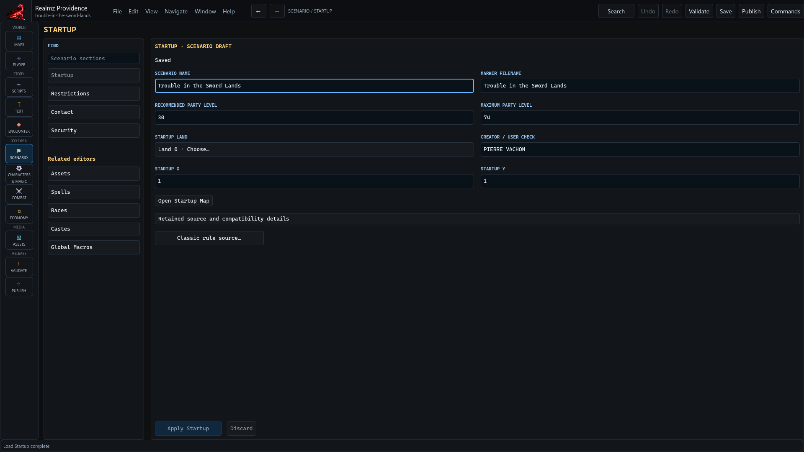

# Set the scenario shell

Open the **Scenario** activity to reach **Startup Info**, **Restrictions**,
**Contact Info** and **Security**. These configure the scenario around its maps
and scripts. Edit the relevant form, Apply, then Save.

## Choose the beginning

Set a starting map that exists and a coordinate within its playable area. Check
the corresponding square in Maps. A start record does not make a solid or
otherwise inaccessible route walkable. Imported invalid starts may be retained
with warnings; that does not make Play succeed at those locations.

Review party restrictions and the rule selection appropriate to this scenario.
Do not assume one menu selection is correct for every legacy campaign. Record
an unresolved choice before making a compatibility or gameplay claim.

## Connect global behavior

Use **Story → Global Macros** for the scenario's global hooks. Select the intended
saved target for each hook and inspect its ordered actions. Startup, party-death,
end-adventure, shop and temple hooks have different callers and purposes. A
reward, departure or ordinary relocation is not automatically a successful
scenario ending.

Use **Quests** for the existing quest labels and references. A label helps an
author recognize a native quest number; it does not introduce an automatic
eligibility or walkthrough system. Inspect both the actions that change a quest
and the actions that test it.

Contact and security/registration fields retain their own native semantics.
Editing those fields is not proof of independently observed Classic registration
behavior. Consult the [evidence guide](source-evidence-guide.md) when assessing
such compatibility claims.
