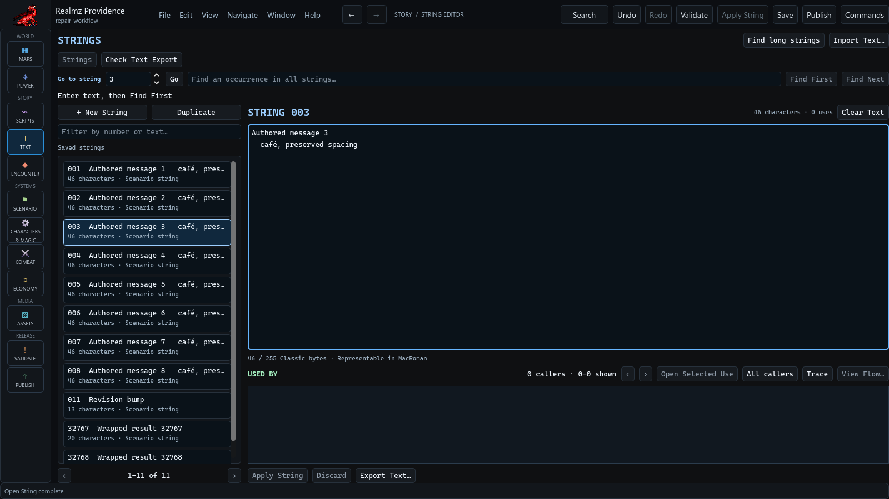

# Write scenario messages

In the native **Strings** workbench, use **Filter by number or text…** to narrow
the saved strings, or enter a number in **Go to string** and choose **Go**.
Selecting a saved string opens its full text. It does not create a replacement
for a missing number.

This is a fresh capture of the current development editor using an authored
sample. Its high-bit character, line break and indentation are real stored text.

## Edit, apply and save

Edit the large text field, then choose **Apply String**. The field's Classic-byte
feedback shows the length and whether the text is representable in MacRoman.
Scenario messages have a 255-byte payload limit. Unsupported characters are
reported; replace them deliberately instead of expecting a safe substitution.
Representable characters, line breaks and meaningful whitespace are retained.

**Discard** restores the applied value. **Clear Text** stages empty text; apply
that change deliberately. **+ New String** and **Duplicate** create through their
existing native workflows. Check the selected record number before using it in
an Action Point or encounter.

Apply updates project history. **Save** persists the project. Undo and Redo
restore applied values; unapplied typing stays protected by the editor's draft
guard. If an operation's outcome is uncertain, follow the recovery instruction
before trying the mutation again.

## Find text and callers

**Find an occurrence in all strings…**, **Find First**, and **Find Next** search
the message text. **Find long strings** helps locate lengthy entries.
**Used By** shows callers of the selected string; use its paging and exact open
action to follow a known reference. A count of zero is not proof that no script
can calculate that message number at runtime.

**Import Text…** and **Export Text…** have their own review and file boundaries.
Review an import's proposed changes before applying it. **Check Text Export**
provides the existing export checks; it does not certify an entire scenario.

Message zero has instruction-specific meaning. In Display Random Message, zero
means no message, and the sign of a nonzero result controls waiting. See
[Random Message repair](random-message-repair.md) before replacing unusual
imported endpoint settings.
