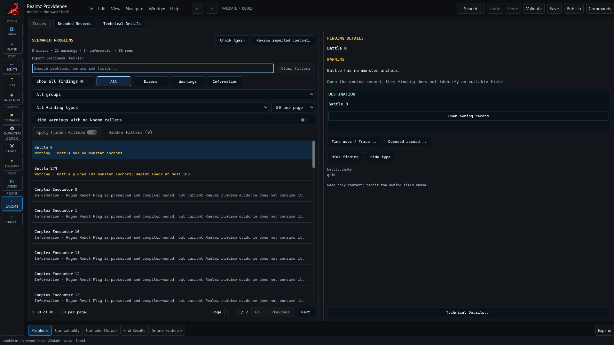
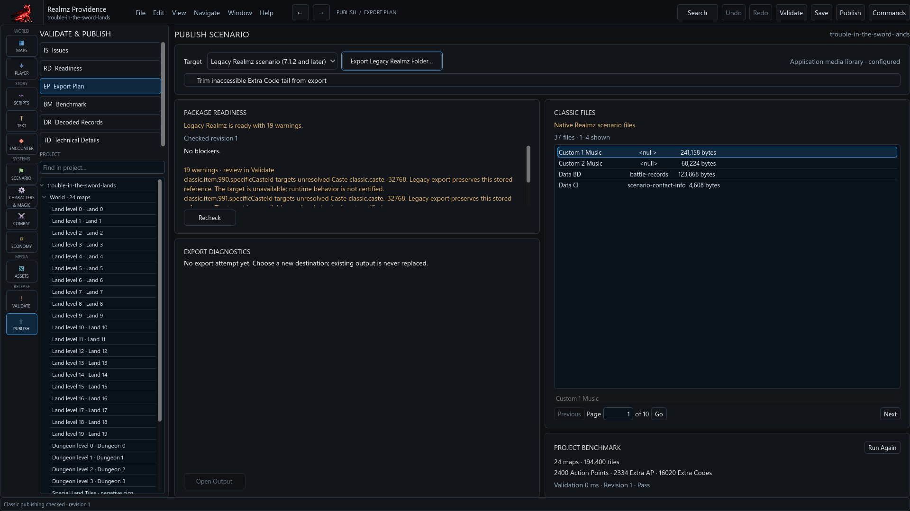

# Validate and publish a scenario

Apply the drafts you intend to publish, then Save. **Validate** and **Publish**
work from applied project state. A current finding or readiness result belongs
to its inspected revision and target.

## Resolve the useful findings

Start with the actionable findings. Use their exact owning-editor navigation or
available guided repair, then return to refreshed Issues. **Show all findings**
also exposes preservation details. Occurrence counts and grouped rows are
different views of the same diagnostic inventory.

Review a repair's proposed effect, sharing scope and target before Apply. Cancel
leaves the draft unapplied. Shared settings require explicit caller confirmation
where that workflow supports it; they are not permission to update every caller.
See [Random Message repair](random-message-repair.md) for a complete example.

## Select the target

Choose the target and **Recheck** its readiness and file plan. **Export Selected
Target…** writes the selected output. Configure the exact application support
required by Rebuilt; missing or stale support is a configuration failure to
resolve before publishing. Confirm the scenario's applicable Classic rule choice
instead of treating one fallback profile as universally correct.

Classic export and a Rebuilt package serve different consumers. Current
development writers use v7 for imported scenarios and v6 for authored scenarios
and the stock application package. Existing archives and older schema contracts remain
readable; they are not relabelled. The editable project snapshot has its own
version. The published beta's split is documented in [package versions](package-versions.md).

Export creates new output and does not overwrite existing files. Inspect the
chosen destination and actual export receipt. If you deliberately choose **Trim
inaccessible Extra Code tail from export**, review that output change separately
from exact no-edit preservation; the retained project source is distinct.

## Verify what the player receives

Readiness can be ready, ready with warnings or blocked. Imported preservation
warnings do not guarantee safe execution of missing content. Check the produced
archive with the paired runtime and exercise startup, transitions, consequential
choices and Save/reload. Keep runtime build/support identities with test notes.

**Open Output** leads to the completed output. The project benchmark measures
its named operations; it is not an export or a gameplay certificate. A failed
export, canceled job or runtime crash must not be reported as a successful
published campaign.
